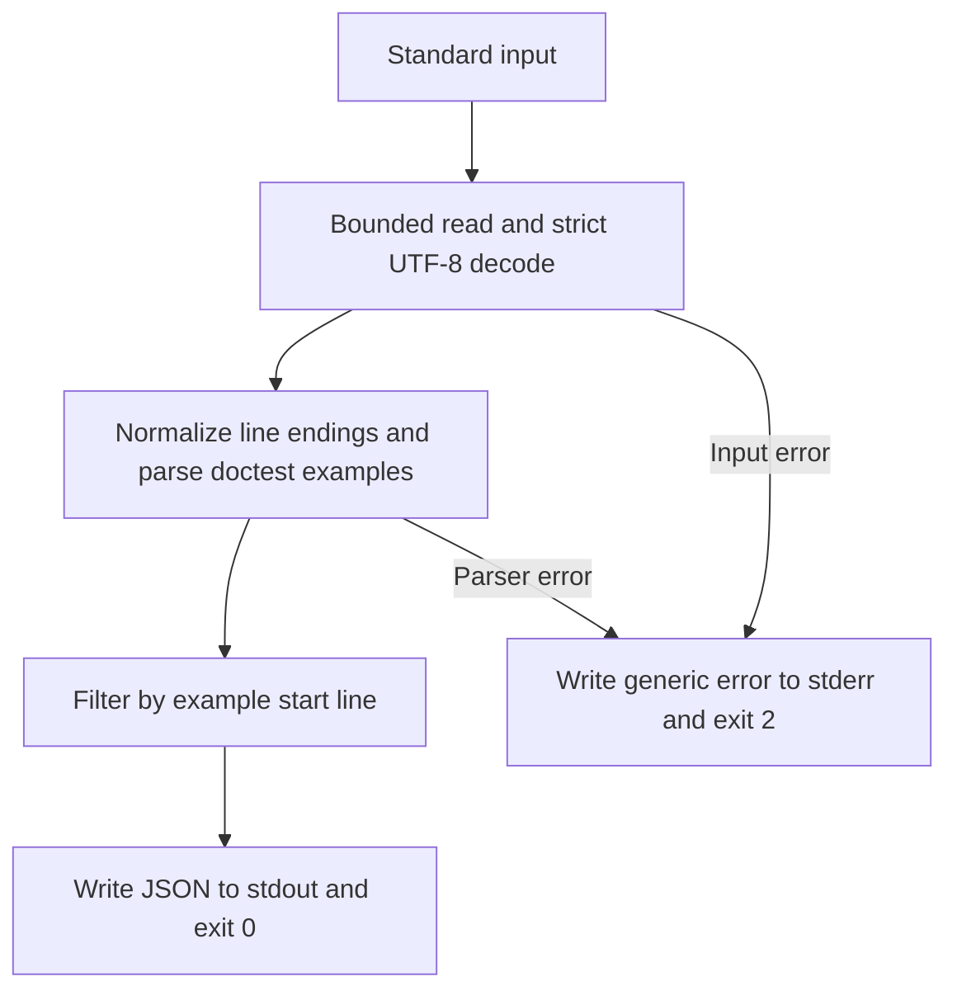

# doctest-transcript

`doctest_transcript.py` extracts Python prompt examples from tutorial text. It uses only the Python 3.11+ standard library. The CLI reads UTF-8 from standard input, writes JSON to standard output, and never evaluates the examples.

```sh
python doctest_transcript.py --start-line 3 --end-line 4 <<'EOF'
A short tutorial

>>> 2 + 2
4

>>> print("hello")
hello
EOF
```

```json
[{"line": 3, "source": "2 + 2\n", "expected": "4\n"}]
```

Omit both flags to extract every example. Each flag sets an inclusive bound on the 1-based line where the `>>>` prompt starts. The shell can also supply a file with `python doctest_transcript.py < tutorial.txt`.

## Output and limits

- Results appear in input order. Each object has `line`, `source`, and `expected`. `source` ends in a newline. `expected` ends in a newline when output is present and is an empty string otherwise.
- Input is capped at 256 KiB (262,144 bytes) before decoding. CRLF and CR line endings are normalized to LF. Prompt removal, indentation, tabs, expected output, and doctest directives follow `doctest.DocTestParser` behavior.
- The parser scans the entire input before filtering. Invalid UTF-8, oversized input, and formatting errors reported by `DocTestParser` produce a generic error on stderr and exit status 2. Invalid CLI arguments also exit with status 2. Successful extraction exits with status 0, including when the result is `[]`.
- Extraction follows doctest prompt syntax. It does not validate Python syntax or check that the expected output is correct. The CLI accepts input only through standard input and creates no output files.

## Architecture



## Isolated validation

Run the standard-library CLI tests in the factory's isolated environment with `python -m unittest discover -s tests`.

## License

The project code, tests, and documentation are original and distributed under the [MIT License](LICENSE). The extractor calls Python's standard-library `doctest` module without bundling its source.
